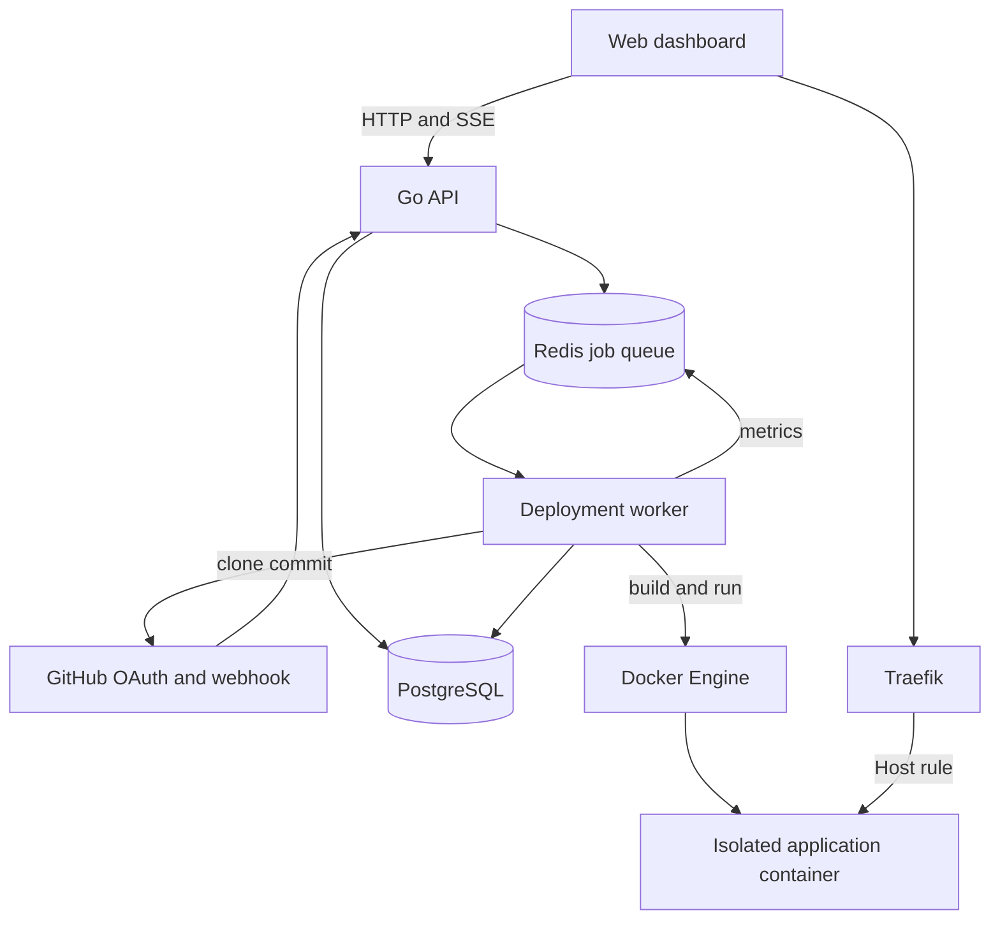

# Architecture

DeployHub is split into a control plane and a runtime plane.

## Deploy lifecycle

1. The API validates the request and inserts a deployment with status `queued`.
2. The API pushes a small job into the Redis pending list.
3. A worker atomically moves the job to the processing list.
4. The worker clones the selected branch and checks out the requested commit.
5. An existing Dockerfile is used when present. Otherwise a buildpack Dockerfile is generated for Node.js, Python, or Java.
6. The image is built and labeled with its project and deployment identifiers.
7. A candidate container starts without a public route. The worker calls its health check directly.
8. After a successful check, the routed container starts with Traefik labels and resource limits.
9. The previous container is removed only after the replacement is running.
10. Build and runtime logs are written to PostgreSQL. The dashboard receives updates through SSE.

## Queue recovery

The pending and processing lists are separate. When the worker claims a job it moves the payload into the processing list. On clean completion it removes the payload. After a worker restart, unacknowledged payloads are returned to the pending list.

## Runtime isolation

Application containers receive:

* a memory limit and matching swap limit
* a CPU quota
* a process limit
* dropped Linux capabilities
* `no-new-privileges`
* a read only root filesystem
* an isolated temporary filesystem
* access only to the runtime Docker network

This is useful isolation for a single host pet project, but it is not a hostile multi tenant sandbox. A production platform should build with rootless BuildKit and run workloads on separate nodes or microVMs.
